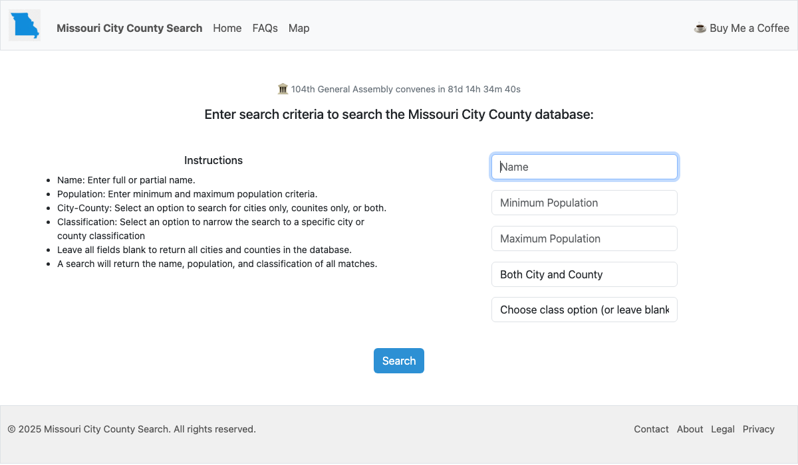

# Missouri City County Search

**Live site: [www.mocitycounty.com](https://www.mocitycounty.com)**

I wrote this web app for searching population and legal classification data for every city and county in Missouri. The task of reading statutory language and working backwards to find the city or county it describes was a manual and laborious process. This app speeds up this research task that routinely comes up when reading and drafting Missouri legislation.



## The problem

The Missouri Constitution generally prohibits "special laws" aimed at a single place, so bills often describe a place by its population and classification instead of its name. For example:

> "Any county with more than forty thousand but fewer than fifty thousand inhabitants and with a county seat with more than fourteen thousand but fewer than eighteen thousand inhabitants."

Working out which county that means (Butler County, county seat Poplar Bluff) normally means digging through the population tables in the Missouri Official Manual (the "Blue Book"). This site turns that into a quick search.

## Features

- **Search** all 114 Missouri counties and 1,085 cities, villages, and census-designated places by name (full or partial), population range, city/county type, and legal classification
- **Results table** showing name, type, population, classification, and county or county seat
- **Contact form** that sends messages to the site's inbox through Gmail SMTP
- **Countdown** to the next Missouri General Assembly session start or end, updated live in the browser
- **Privacy-conscious usage logging:** anonymous search terms are written to monthly CSV files, and a scheduled job emails the previous month's log to the site owner. No IP addresses or other personal data are collected.
- Responsive layout built with Bootstrap 5

## Tech stack

| Layer | Tools |
|---|---|
| Backend | Python, Flask, Flask-Mail, python-dotenv |
| Database | SQLite |
| Frontend | Jinja2 templates, Bootstrap 5, vanilla JavaScript |
| Hosting | PythonAnywhere (WSGI), Cloudflare DNS, Let's Encrypt HTTPS |

## How it works

1. A user fills in any combination of search fields on the home page.
2. `clean_data()` normalizes the input: blank fields become SQL wildcards or open-ended population bounds, and names are trimmed and wrapped for partial matching.
3. `get_search_results()` runs a **parameterized** SQLite query, so user input is never inserted directly into SQL.
4. Results render in a Jinja2 table, and the search terms are appended to that month's log file. Logging is wrapped so that a logging failure can never break a search.

```
app.py              Flask routes, search logic, and logging
email_log.py        Monthly log email, run daily as a PythonAnywhere scheduled task
citycounty.db       SQLite database of city and county data
templates/          Jinja2 page templates
static/             CSS and countdown.js
```

## Data sources

- Missouri Official Manual (Blue Book), Missouri Secretary of State
- U.S. Decennial Census population figures, via the Office of the Missouri State Demographer

This site is for educational and informational purposes. Check official sources before relying on the data.

## Run it locally

```bash
git clone https://github.com/bdscheiderer/citycounty.git
cd citycounty
python3 -m venv .venv
.venv/bin/pip install -r requirements.txt
```

Create a `.env` file in the project folder:

```
FLASK_SECRET_KEY=any-random-string
MAIL_USERNAME=your-gmail-address
MAIL_PASSWORD=your-gmail-app-password
```

Then start the development server and open http://127.0.0.1:5000:

```bash
.venv/bin/python app.py
```

Search works without the mail settings; they're only needed for the contact form and the log email.

## Roadmap

- **Natural-language search:** paste a statutory description like the example above and have the app parse it into search criteria automatically (in progress)
- Explanations of Missouri's city and county classification systems on the FAQ page

## License

[MIT](LICENSE) © 2025 Bryan Scheiderer
